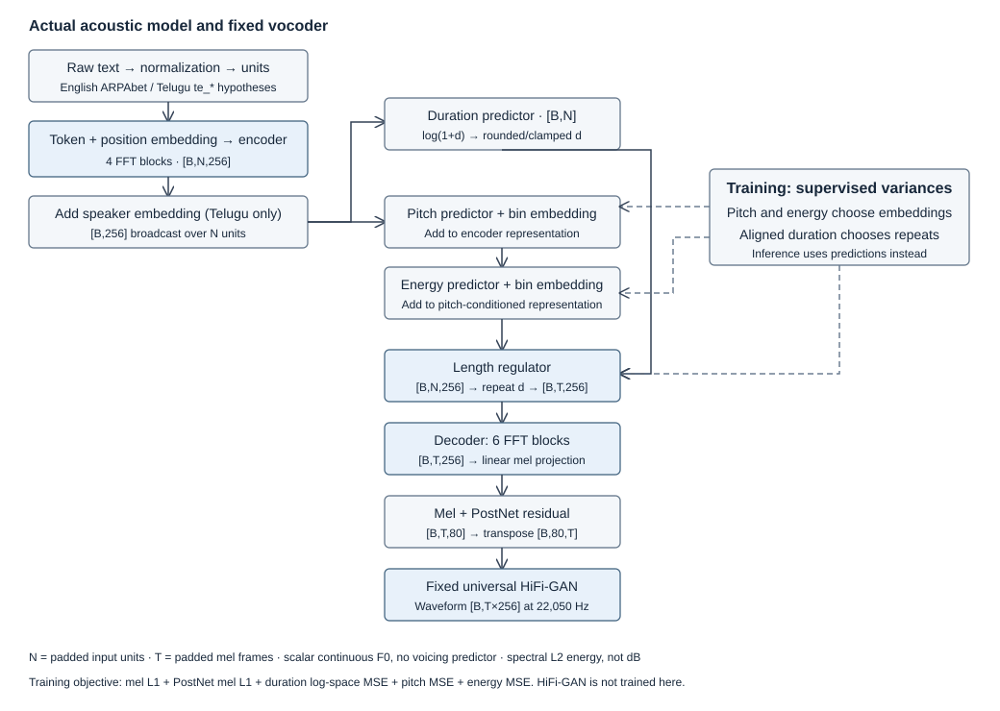

# Architecture and results

This guide follows the implementation from dataset selection to speech. The report contains all ten sentence analyses; the README provides setup and the short project overview.

## Execution flow



Dataset → text processing → forced alignment → acoustic features → FastSpeech 2 training → predicted variances and mel → fixed HiFi-GAN → waveform checks and analysis.

The two acoustic models were trained separately from initialization. HiFi-GAN is a pretrained, fixed waveform generator. The implementation uses ming024's scalar-F0 variant with a Tacotron-style PostNet, not FastSpeech 2s or the later CWT pitch representation.

## 1. Dataset selection

**Code:** [download_data.py](scripts/download_data.py), [data.py](shared/data.py).

Inputs are pinned parquet snapshots: Svarah revision `ebbf7777fe771490696a3f7b007097606fa8c924` and IndicTTS Telugu revision `7ab3c18491bef3f5d4e820c2701b5f78f54031d6`. Outputs are local audited rows and train/validation JSONL manifests. Full corpora and transcript-bearing manifests are ignored; [selection_index.json](data/manifests/selection_index.json) retains source IDs, durations and hashes.

The audit rejects invalid, near-silent, excessively clipped or duplicate audio and unsupported text. Whole utterances of at most 30 seconds are selected with seed 2026. Connected transcript/original-recording groups stay in one split; duration-based allocation balances available speaker groups. This prevents the documented exact ID/audio/transcript overlap. The conservative split skeleton groups some distinct Telugu spellings together but never becomes model text. No fuzzy-duplicate guarantee is claimed.

| Language | Accepted train | Accepted validation | Rejected after selection |
|---|---|---|---:|
| English | 3,354 utterances; 4.957436 h | 658; 1.007724 h | 30 of 4,042 |
| Telugu | 1,500 utterances; 4.943982 h | 315; 1.005290 h | 14 of 1,829 |

English speaker IDs are unavailable. `unknown_mixture` is bookkeeping, not one speaker, and the model has no speaker embedding. Telugu provides two speaker labels; both train the model, and the more represented female label is used for submitted samples.

## 2. Text processing

**Code:** [text.py](shared/text.py), [create_test_manifest.py](scripts/create_test_manifest.py).

Input text becomes normalized words and linguistic-unit sequences. Raw assignment strings remain separate in [test_sentences.json](data/test_sentences.json). English uses CMUdict and g2p-en fallback. An explicit context rule selects noun/verb pronunciations of `conduct`; the network did not learn that distinction from raw spelling alone. Dates and times expand symbolically. The supplied `rhyth m` split and `andaroo` remain.

Telugu uses Unicode NFC and mappings for consonants, inherent vowels, vowel signs, virama and marks. These are orthography-derived pronunciation hypotheses, not a validated phonetic transcriber. Number/time composition uses small-number lexical entries and explicit scale/ordinal rules. Unsupported symbols fail explicitly. Alignment dictionaries and inference use the same units.

The current test sentences were checked visually against the assignment PDF. [assignment_source.json](analysis/assignment_source.json) records its hash, extraction policy and Telugu codepoints. The manifest separates original text from normalized words and model units.

## 3. Forced alignment

**Code:** [alignment.py](shared/alignment.py), [mfa_telugu.yaml](references/mfa_telugu.yaml), [patch_mfa.py](scripts/patch_mfa.py).

Training needs one duration target per unit. MFA takes 16 kHz local audio, word labels and a pronunciation dictionary, and returns TextGrids. Opaque word IDs prevent MFA cleaning from changing Telugu dictionary spellings. English uses `english_us_arpa`; Telugu trains its own HMM/GMM aligner on the training split. No English acoustic aligner is applied to Telugu.

Validation uses fixed aligner weights. The recorded Telugu run exported speaker-independent first-pass alignments; no validation fMLLR adaptation appears in its log. The MFA 3.3.9 patch prevents labels such as `te_aa` being stripped to `te`. It changes parsing, not acoustic weights. Phone order and frame sums are checked, but boundaries were not manually validated.

## 4. Acoustic features

**Code:** [features.py](shared/features.py), [batches.py](shared/batches.py).

Aligned audio is resampled to 22,050 Hz and converted to 80-bin natural-log magnitude mels. FFT/window 1,024, hop 256, reflect padding 384 per side and `center=False` match the retained HiFi-GAN recipe. WORLD estimates F0. Voiced F0 is interpolated through unvoiced regions, then pitch and spectral-L2 energy are averaged over aligned units.

Only training data determines normalization and variance-bin ranges. Pitch statistics use voiced WORLD frames, excluding zero-Hz unvoiced frames. Local NPZ outputs contain tokens, durations, standardized pitch/energy and mels. Continuous F0 is not a voicing predictor; spectral L2 energy is not dB or calibrated loudness. This corpus pipeline replaces upstream preprocessing while retaining its scalar pitch approach.

## 5. FastSpeech 2

**Code:** [model.py](shared/model.py), [fastspeech2.py](vendor/fastspeech2/model/fastspeech2.py), [modules.py](vendor/fastspeech2/model/modules.py), [transformer](vendor/fastspeech2/transformer/).

Token embeddings and positional encodings enter four FFT encoder blocks. Attention supplies context; convolutional feed-forward layers transform each representation. Telugu adds a learned speaker vector at every unit position.

The **variance adaptor** predicts log duration, pitch and energy. Duration is predicted before variance conditioning. Pitch embeddings are added before energy prediction, then energy embeddings are added. Training supplies target pitch/energy and aligned durations; inference uses predictions.

The **length regulator** repeats each conditioned vector for its duration in mel frames, converting unit time to acoustic time. Six FFT decoder blocks produce frame representations, a linear projection produces 80 mel channels, and the **PostNet** adds a residual correction.

The adaptation retains upstream attention, FFT blocks, PostNet, speaker addition and loss math. Changes configure vocabulary size, extend positional encodings, use tensor-local devices and `repeat_interleave`, zero padded durations and fix the energy-control argument. These are implementation changes rather than a new architecture. The source commit is `d4e79eb52e8b01d24703b2dfc0385544092958f3`; both vendored MIT licenses remain.

## 6. Training and checkpoint selection

**Code:** [train.py](shared/train.py), [loss.py](vendor/fastspeech2/model/loss.py), [English config](English/config.yaml), [Telugu config](Telugu/config.yaml).

The equally weighted objective sums masked mel L1, PostNet-mel L1, log(1 + duration) MSE, standardized pitch MSE and standardized energy MSE. Its mixed-unit total is not a perceptual speech score.

Both models use width 256, two attention heads, feed-forward width 1,024, encoder/decoder dropout 0.2 and predictor dropout 0.5. Adam uses betas 0.9/0.98, epsilon 1e-9, a 4,000-step warmup and gradient clipping at 1.0. English batch 16 × accumulation 2 and Telugu 8 × 4 both give effective batch size 32. Training used BF16 on an A100 40 GB. Validation plateau stopping ended both runs before the configured 30,000-step ceiling.

| Quantity | English | Telugu |
|---|---:|---:|
| Final training step | 8,000 | 14,500 |
| Selected inference step | 8,000 | 10,500 |
| Minimum objective step | 1,000 | 10,500 |
| Minimum validation total | 3.582084 | 1.977242 |
| Selected logged validation total | 3.879625 | 1.977242 |

English training loss fell while validation did not keep improving: the minimum teacher-forced objective occurred early. A fixed six-utterance validation-only Whisper probe selected the later checkpoint: 34/129 word errors at step 1,000 versus 10/129 at step 8,000. This reused small probe measures an intelligibility proxy, not held-out naturalness. Telugu selected its objective minimum. Assignment sentences were not used for checkpoint selection.

`selected.pt` is for inference, `best.pt` stores the objective minimum, and `latest.pt` supports resumption. Checkpoints embed vocabulary, normalization, speaker metadata, optimizer and RNG states. [English records](analysis/english/) and [Telugu records](analysis/telugu/) distinguish final training steps from selected checkpoints.

## 7. Inference and vocoder

**Code:** [inference.py](shared/inference.py), [vocoder.py](shared/vocoder.py), [HiFi-GAN](vendor/fastspeech2/hifigan/models.py).

Inference validates a selected checkpoint's configuration and vocabulary, predicts variances/mels without target acoustics, then exports arrays and checkpoint hashes. Boundary silence is explicit. The PostNet mel feeds fixed universal HiFi-GAN, which produces 22,050 Hz mono PCM16 WAVs. No random-weight synthesis or Griffin-Lim fallback is used.

Checks require finite, non-silent audio, the expected sample rate and limited clipping. Predicted frames × 256 must equal WAV samples. These establish technical consistency, not intelligibility. November 7 regeneration used Python 3.12 and CPU PyTorch 2.12.1; original training remains the Linux/PyTorch 2.5.1 experiment. Runtime-specific numerical differences are recorded separately.

The clean-source E2a check preserves input units and integer durations, but its CPU waveform differs from the saved GPU recording. Exact cross-runtime waveform identity is not claimed. The corresponding corrected T2a comparison stays within one PCM16 rounding step. These are reproduction checks, not additional speech-quality experiments; the original English files remain unchanged.

## 8. Evaluation and interpretation

**Code:** [evaluate.py](scripts/evaluate.py), [plot_results.py](scripts/plot_results.py), [check_artifacts.py](scripts/check_artifacts.py), [make_report.py](scripts/make_report.py).

Teacher-forced validation supplies target duration/pitch/energy. Saved selected-checkpoint duration MAE is 4.521993 frames for English and 1.827206 for Telugu; mostly-voiced-unit F0 RMSE is 66.321863 and 28.363927 Hz. These are conditional measurements. Corpus, speaker, recording and alignment differences prevent attributing the lower Telugu error to language alone.

Preserved diagnostics compare original audio, reference-mel vocoding, target-variance synthesis and full inference on a small reused validation subset. Recognition, timing and reconstruction can disagree. Unconstrained DTW can hide repetitions and is not a timing score. The main report summarizes these findings. [Historical numerical records](analysis/supplement/) remain distinct from corrected assignment outputs.

English ASR flags E1's long word, while E2a/E2b transcript agreement cannot verify lexical stress. E3/E4 exercise spacing and number/code-switch handling. Corrected Telugu has current numerical variance observations; recognition results from other inputs are not used. No new recognizer experiment or human listening score was introduced. Pronunciation, robotic delivery, accent and voice consistency still require listening assessment. Naturalness and production readiness are not established.

## Reproduction

Use the README's inference commands first. [download_artifacts.py](scripts/download_artifacts.py) retrieves selected models and the exact vocoder from the public release and verifies size/SHA256. The release contains the selected inference checkpoints; the trained-model parameters are unchanged. HiFi-GAN is downloaded from its original upstream location.

For a preprocessing rebuild, install MFA separately in a compatible conda/micromamba environment:

```bash
micromamba create -p .mfa-env --file references/mfa-linux-64.lock
.mfa-env/bin/python scripts/patch_mfa.py
export PATH="$PWD/.mfa-env/bin:$PATH"
mfa model download acoustic english_us_arpa
```

Run README dataset/preprocess/train commands in a separate checkout, after moving existing metrics logs aside. `--stage data`, `corpus`, `align` and `features` support staged preprocessing. The recorded training runs are retained.

Rebuild figures/report only in a reproduction checkout:

```bash
python scripts/plot_results.py
python scripts/make_report.py
python scripts/build_results_viewer.py
python -m pytest -q
python scripts/check_artifacts.py
```

The report builder uses installed Chromium (`--browser` selects it), or the pinned WeasyPrint environment. It reads saved evidence and runs no experiments. [references/python-lock.txt](references/python-lock.txt) records the original Python environment; MFA and OS libraries are separate dependencies.

## Access, licenses and provenance

[NOTICE](NOTICE), [FastSpeech 2 MIT](vendor/fastspeech2/LICENSE), [HiFi-GAN MIT](vendor/fastspeech2/hifigan/LICENSE) and the [IndicTTS EULA](references/licenses/IndicTTS_EULA.pdf) are retained. Svarah declares CC BY 4.0 and requires legitimate access. IndicTTS has a custom EULA; the unavailable website copy could not be compared with the archived provider copy. HiFi-GAN code licensing does not independently establish public weight redistribution rights.

The public repository contains the final source and results in one initial commit. Acoustic checkpoints are released separately under [models-v1](https://github.com/praneet3t/fastspeech2-en-te/releases/tag/models-v1). Integrity hashes remain in the artifact manifest; raw corpora and third-party vocoder weights are not redistributed.
