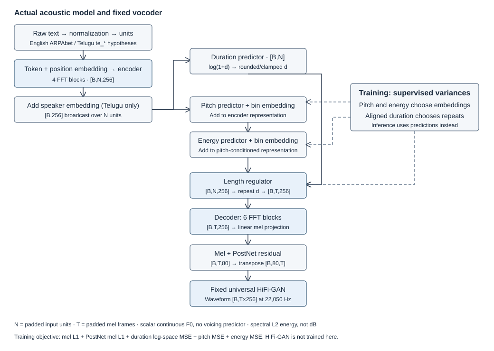
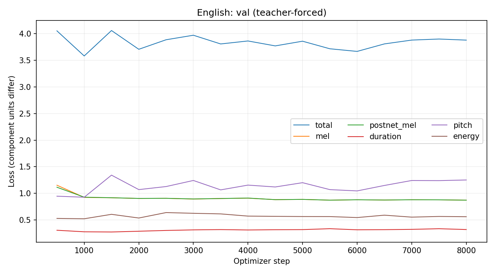
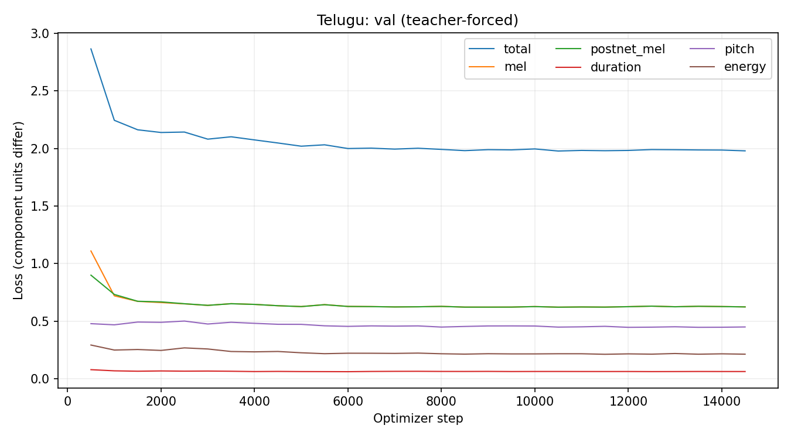

# FastSpeech 2 for English and Telugu

I trained separate FastSpeech 2 acoustic models on Svarah English and IndicTTS Telugu, then generated the assignment sentences with a fixed HiFi-GAN vocoder. This repository contains the implementation, training records, ten recordings, variance predictions and technical report.

## Architecture



The retained [ming024 implementation](https://github.com/ming024/FastSpeech2/tree/d4e79eb52e8b01d24703b2dfc0385544092958f3) uses scalar F0 and a PostNet. See [architecture and results](ARCHITECTURE_AND_RESULTS.md) for the execution flow and code links.

## Results

| Language / dataset | Accepted train / validation | Final training step | Selected step | Main limitation |
|---|---|---:|---:|---|
| English / Svarah | 4.957436 / 1.007724 h | 8,000 | 8,000 | Unconditioned speaker mixture; difficult-word errors |
| Telugu / IndicTTS | 4.943982 / 1.005290 h | 14,500 | 10,500 | Orthography-derived units; pronunciation unverified |




Lower reconstruction loss does not establish natural speech or a fair ranking between languages. No MOS or qualified listening study was conducted.

## Audio samples

English: [E1](Results/English/test_generated_audios/E1.wav) · [E2a](Results/English/test_generated_audios/E2a.wav) · [E2b](Results/English/test_generated_audios/E2b.wav) · [E3](Results/English/test_generated_audios/E3.wav) · [E4](Results/English/test_generated_audios/E4.wav)

Telugu: [T1](Results/Telugu/test_generated_audios/T1.wav) · [T2a](Results/Telugu/test_generated_audios/T2a.wav) · [T2b](Results/Telugu/test_generated_audios/T2b.wav) · [T3](Results/Telugu/test_generated_audios/T3.wav) · [T4](Results/Telugu/test_generated_audios/T4.wav)

Save/open [results.html](results.html) locally to listen alongside all plots. The Telugu inputs match the assignment PDF. All ten recordings and their current model predictions are included.

## Repository structure

```text
English/, Telugu/           preprocessing, training, inference, config, checkpoints
shared/, vendor/fastspeech2/ corpus pipeline and retained model implementation
Results/                   ten WAVs, 30 variance plots, four loss graphs
Report/Technical_Report.pdf one complete technical report
analysis/, data/            numerical evidence and verified test inputs
scripts/, tests/            reproduction tools and automated checks
references/                environment locks, architecture diagram and license
```

## Run it

Training was tested on Linux, Python 3.10, PyTorch 2.5.1/CUDA 12.1 and an A100 40 GB. Install GitHub CLI, ffmpeg, libsndfile, Poppler, Noto Telugu fonts and Pango, then:

```bash
bash scripts/setup.sh
source .venv/bin/activate
python scripts/download_artifacts.py
mkdir -p artifacts
cp data/test_sentences.json artifacts/reviewer_tests.json
python English/inference.py --test-manifest artifacts/reviewer_tests.json --output-root artifacts/reviewer_inference
python Telugu/inference.py --test-manifest artifacts/reviewer_tests.json --output-root artifacts/reviewer_inference
```

The downloader retrieves the two public acoustic checkpoints and the original upstream vocoder, then verifies their sizes and hashes. Checkpoints include the vocabulary, speaker map and feature statistics, so inference needs no training corpus. The manifest copy keeps submitted evidence intact.

For preprocessing/training in a **separate checkout**, first obtain dataset access and install MFA 3.3.9 as described in [the reproduction section](ARCHITECTURE_AND_RESULTS.md#reproduction):

```bash
hf auth login
python scripts/download_data.py english
python scripts/download_data.py telugu
python English/preprocess.py
python Telugu/preprocess.py --train-aligner
python English/train.py
python Telugu/train.py
```

Archive the supplied `analysis/{english,telugu}/metrics.jsonl` before starting a new run; the trainer refuses to overwrite an existing log. `--resume` requires the corresponding saved run and local features.

## Report and references

[Technical report](Report/Technical_Report.pdf) · [Architecture and results](ARCHITECTURE_AND_RESULTS.md) · [FastSpeech 2 paper](https://arxiv.org/abs/2006.04558) · [Source implementation](https://github.com/ming024/FastSpeech2) · [Svarah](https://huggingface.co/datasets/ai4bharat/Svarah) · [IndicTTS Telugu](https://huggingface.co/datasets/SPRINGLab/IndicTTS_Telugu)

## Reproducibility and limitations

The two selected acoustic checkpoints are downloadable from the [models-v1 release](https://github.com/praneet3t/fastspeech2-en-te/releases/tag/models-v1). Run [download_artifacts.py](scripts/download_artifacts.py) to obtain them and the original upstream HiFi-GAN checkpoint, with size and SHA256 checks from [the artifact manifest](analysis/release/artifact_manifest.json). No GitHub login is required. The third-party vocoder weights are downloaded from their original source rather than rehosted here.

Raw corpora, transcript-bearing manifests, feature caches and local working files are ignored. Numerical evidence remains under `analysis/`. Dataset access conditions, [NOTICE](NOTICE), the [IndicTTS EULA](references/licenses/IndicTTS_EULA.pdf) and the vendored MIT licenses apply.

```bash
python -m pytest -q
python scripts/check_artifacts.py
```

Some data-dependent tests skip in a source-only checkout. Original training used Linux/PyTorch 2.5.1; the Windows CPU check uses a newer runtime and does not reproduce original GPU waveforms byte for byte. No MOS or qualified native listening study was conducted.
